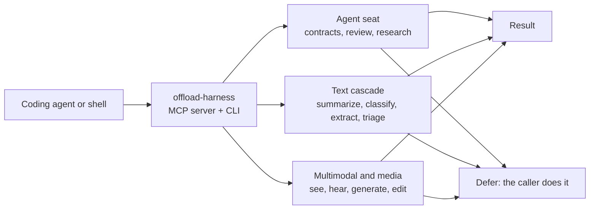

<div align="center">

# offload-harness

**Hand bulk work to models on your own GPUs. Keep your cloud tokens for judgment.**

offload-harness gives a coding agent free local seats. They read files and answer from them, review diffs, digest web pages, look at images, watch video, transcribe audio, and generate images, video, voice and music. It is one Go binary, a CLI and an MCP server. When a seat can't do a job it returns a structured defer and your agent takes the job back. It never falls back to a cloud model by itself.

[](LICENSE)
[](https://pkg.go.dev/github.com/dmmdea/offload-harness)
[](https://modelcontextprotocol.io)

</div>

## What it does

| Lane | You hand it | You get back |
|---|---|---|
| [Agent seat](#the-agent-seat) (the main lane) | A contract: a goal, files, an output schema and acceptance checks | A result that passed those checks, or a diff you apply yourself |
| [Text cascade](#the-text-cascade) (the quick door) | One text and one mechanical question | A summary, a label, fields or a yes/no, in seconds |
| [Multimodal and media](#multimodal-and-media) | An image, audio, video or a prompt | An answer about it, or a new file |



All three run on your own cards, on this machine or on another machine in your [fleet](#more-than-one-machine).

## The agent seat

A seat is a local model running a tool loop over the files you give it. Reach for it when answering would mean opening more than a couple of files yourself.

| Door | Use it for |
|---|---|
| `offload_ask` | A bounded question about specific files. You pass the question and the paths, and the harness writes the contract, including a check anchored to tokens mined from those files. |
| `agent_delegate` | One to eight contracts of your own, fanned out across this box and the fleet. |
| `agent_run` | One goal through the local agent loop, with read-only tools. |
| `offload_review_diff` | A second reader for a diff. The seat sees the diff and the task statement and nothing of your session, so it doesn't share your blind spots. |
| `offload_research` | A goal and a list of URLs. The harness fetches the public pages itself and hands each one to a seat as a digest contract. The seats never touch the network. |

A contract looks like this:

```json
{
  "goal": "List every ADR number mentioned in the attached page.",
  "context_paths": ["docs/architecture/decisions/README.md"],
  "output_schema": {"properties": {"numbers": {"type": "array", "items": {"type": "string"}}}},
  "acceptance": ["min_items:numbers:1"]
}
```

```bash
offload-harness delegate --contract contract.json --read-root .
```

The MCP tool takes the same object inside a `subtasks` array. The files are inlined on the caller's side, so your context never pays for them.

A result counts as done only after the harness runs the acceptance checks itself (`contains:`, `not_contains:`, `regex:`, `min_items:`, `nonempty:`). An answer that fails comes back as `failed_verification`, never as a success, and it gets one retry on a different node. Set `lint_only` to preview a contract's checks and placement without running anything.

A seat is read-only unless you open the write door. With `write_root` set, and `agent_allow_write` on the node, it edits a throwaway copy of the files and returns a unified diff that you review and apply. The harness never applies it. The door stops at 8 files and 64 KiB written, with no delete, shell, run or network.

The installer picks the seat from your hardware tier: Gemma 4 E2B on a 3 GB card, Qwen 3.5 4B at 6 GB, MiMo 9B at 8 GB, and Qwen 3.8 27B or Gemma 4 26B at 16 GB and up, served by llama.cpp or vLLM. `offload_status {section:"brief"}` reports what each seat really holds right now, so size contracts from that.

`local-agent` is the same loop as a standalone binary, with write, run, fetch and GitHub tools behind `--allow-*` flags that all start off. See [the flags](docs/REFERENCE.md#the-local-coding-agent).

## The text cascade

For one text and one mechanical question, the cascade answers faster than a contract. It is a short ladder:

```text
triage, classify:     small model -> workhorse -> bigger model -> reasoning attempt -> defer
summarize, extract:                  workhorse -> bigger model -> reasoning attempt -> defer
```

The defaults are `gemma4-e2b`, `offload-e4b` and `gemma4-26b-a4b`, the last one also taking the reasoning attempt. Each hardware tier seeds only the rungs it can serve. `ampere-6`, `ampere-16` and `amd-gcn` stop at the workhorse, `maxwell-3` and `rockchip-rk3588` run one model, and `doctor` says on its `escalation:` line when a box has nothing above the workhorse.

A generated grammar constrains the output, and the answer is then checked against the schema. Extracted values must appear in the source text, and triage and classify must clear a confidence margin. A failed check climbs a rung. A connection refused or a timeout defers at once. Whatever gets past the top comes back as `{"deferred": true, "reason": "..."}`, which is a normal result that tells your agent to do this one itself.

Every call lands on an append-only ledger, and `ledger` reports the tokens it kept out of the cloud. Offline tuning jobs (`calibrate`, `train-router`, `optimize`, shadow labelling) are opt-in. See [self-improvement](docs/systems/self-improvement.md).

## Multimodal and media

| Job | Tools | Runs on |
|---|---|---|
| Ask about an image, read its text, pull fields from it, QA a render | `offload_vqa`, `offload_ocr`, `offload_extract_image`, `offload_assess_image` | A vision seat: Qwen3-VL on bigger tiers, Gemma 4 vision on smaller ones |
| Transcribe audio or video, with timestamps and an SRT | `offload_transcribe` | whisper |
| Understand a video | `offload_video_describe` (the opening seconds), `offload_video_watch` (the whole file, one frame per second by default, with timestamped notes) | The vision seat, then a text seat for the answer |
| Generate images | `offload_generate_image`, `offload_run_graph` (any ComfyUI graph), `offload_run_template` | ComfyUI or stable-diffusion.cpp: `hidream-o1`, `krea2`, `z-image-turbo` or SDXL by tier, with `qwen-image` and `flux3-klein` as named opt-ins |
| Edit images | `offload_edit_image` (crop, grade, LUT, text, composite), `offload_inpaint_image` (masked), `offload_edit_image_generative` (from an instruction), `offload_upscale_image` (ESRGAN) | PIL on the CPU for the first, ComfyUI for the rest |
| Generate video | `offload_generate_video` (a still into a clip), `offload_animate_character` (a driver video's motion onto a character) | Wan 2.2 or LTX-2.5, Hunyuan as an opt-in, and WAN-Animate-2 |
| Generate voice and music | `offload_generate_audio` | Chatterbox Multilingual, with voice cloning, and ACE-Step |
| Compose motion graphics | `offload_compose_video` | HyperFrames: HTML and CSS into MP4, GIF, PNG frames, or WebM and MOV with alpha. CPU only, no GPU lock |
| Cut media, draw charts | `offload_media` (trim, concat, frames, convert, mux, probe), `offload_generate_svg` | ffmpeg, and plain SVG with no model |
| Forecast a time series | `offload_forecast` | Timestral-209M, forwarded to a fleet node if this box has no model |
| Run on an accelerator | `offload_object_detect`, `offload_image_embed`, `offload_classify_image`, `offload_semantic_segment`, and more per device | Hailo-8L, Coral Edge TPU or the Rockchip RK3588 NPU, [beside the GPU](docs/systems/accelerators.md) |

Lanes are per machine. `offload_status` and `doctor` list what a box has, and a lane it doesn't have defers. Vulkan-only boxes get image, video, voice and music through stable-diffusion.cpp and audio.cpp. Inputs are local paths or `data:` URIs, never remote URLs.

Renders default to each model's quality settings, so a video can take tens of minutes. A model family with a non-commercial licence ships only as a [named opt-in](docs/architecture/decisions/0058-non-commercial-model-families-ship-only-as-named-license-tagged-opt-ins.md). The [media guide](docs/systems/media-generation.md) has the engines, bindings and recipes.

`offload_browse` is a separate opt-in: it [drives your own logged-in browser](docs/systems/browse-lane.md) toward a goal, and deny-listed controls such as publish, send and pay are never offered to it.

## More than one machine

`fleet-serve` turns a box into a node on your tailnet. List nodes in `delegate_remotes` on the box that hands out work, and set `fleet_agent_enabled` on the boxes that take contracts.

- Placement ranks the seats that fit by expected completion time. `route: "spread"` deals a fan-out across every eligible node, and each result says where it ran. A box with several cards counts as [several tiers at once](docs/systems/composite-tier.md), so each task gets the layer that suits it.
- A busy card is a place in line. Renders, training and benchmarks queue on a [machine-wide lease](docs/systems/gpu-lease.md), and a media call can overflow to a free node with its input files in a hash-checked bundle:

  ```bash
  local-offload gpu reserve --wait 8h --drain --unload-seat --for 2h \n    --reason "training run" -- python train.py
  ```

- Idle models unload. Every rendered seat carries a five-minute TTL, so a model sitting idle gives the card back.
- A machine with no GPU can still join. `install client` sets up a [delegation client](docs/systems/delegation-client.md) that places contracts, research and renders on the fleet.
- You can watch it. `fleet-ui` serves a [read-only live page](docs/systems/fleet-overview.md), `top` is the terminal version, and `fleet-smoke` sends one small contract to every node.

## Set it up

The fastest route on Windows is to let your coding agent do it. Point Claude Code, or any capable agent, at this repo and say:

> *Follow `setup/SETUP-AGENT.md` and install the stack.*

It runs `setup/detect.ps1`, `setup/install.ps1` and `setup/selftest.ps1`, and branches on the JSON each one prints. On Linux, start with `setup/install.sh --dry-run`, which prints every decision and changes nothing. macOS builds the binary but has no installer, so bring your own llama.cpp Metal server.

To build from source, with Go 1.26+:

```bash
git clone https://github.com/dmmdea/offload-harness.git
cd offload-harness
go build -o offload-harness .
cp config.example.json config.json

./offload-harness doctor
./offload-harness summarize notes.md --max-points 5 --json
./offload-harness ledger
```

This needs a llama.cpp server behind llama-swap, serving the aliases your config names. [Serving the models](docs/REFERENCE.md#serving-the-models) has the flags. A defer whose reason says `connection refused` means nothing is serving yet.

Then register it with your MCP client:

```bash
claude mcp add offload-harness --scope user -- /path/to/offload-harness mcp
```

`agent_delegate` and `offload_research` register only with `"agent_delegation_enabled": true` in the config. Ask the server what it has with `offload_status {section:"brief"}`.

The help text, `doctor` and the setup scripts call this binary `local-offload`, which is the name the installer gives it. It is the same program under both names.

| Requirement | Detail |
|---|---|
| **GPU** | NVIDIA (CUDA) or AMD, including RDNA3 iGPUs (Vulkan). There are [tiers](docs/tiers/README.md) from a 3 GB card up to 72 GB and multi-card boxes, plus Rockchip RK3588 and a CPU fallback |
| **OS** | Windows, Linux. macOS builds only |
| **Optional, per lane** | `ffmpeg` for audio and video, a whisper seat for speech, ComfyUI or stable-diffusion.cpp for images and video |

`local-offload install detect` tells you your tier, and `local-offload report` writes what it delivers on your box.

## Documentation

- [docs/REFERENCE.md](docs/REFERENCE.md): every CLI verb, the [MCP tool table](docs/REFERENCE.md#exposed-mcp-tools), config keys, serving flags, troubleshooting
- [docs/README.md](docs/README.md): how each system works, and the index of everything else
- [docs/tiers/](docs/tiers/README.md): what each hardware class serves
- [docs/architecture/decisions/](docs/architecture/decisions/README.md): why it works this way

## Security

Text and media work stays on your machines. The cascade holds no cloud credentials and can't escalate to a hosted model, and fleet nodes must be loopback or your own tailnet. Anything that reaches further is something you turn on or call by name: `offload_nim` sends a prompt to an NVIDIA NIM endpoint, `offload_research` fetches the public pages you list, the browse lane's decision endpoint may front a hosted model you chose, and `local-agent`'s `--allow-fetch`, `--allow-search` and `--allow-github` flags reach the hosts you allow, DuckDuckGo and GitHub.

`local-agent` starts read-only, a tighten-only rule table can deny or ask but never allow, and its audit trail lives outside the worktree. The sandbox differs by platform: Linux confines files, network and syscalls, while on native Windows it restricts writes but contains neither reads nor network. The [full posture](docs/REFERENCE.md#security) has the details. Report vulnerabilities through [SECURITY.md](SECURITY.md), not a public issue.

## Contributing

Contributions are welcome. Run `go build ./...` and `go vet ./...` before opening a PR, keep changes scoped, and update the docs in the same PR. CI runs the tests. See [CONTRIBUTING.md](CONTRIBUTING.md).

## License

[Apache 2.0](LICENSE).

## Acknowledgments

Built on [llama.cpp](https://github.com/ggml-org/llama.cpp), [llama-swap](https://github.com/mostlygeek/llama-swap), [vLLM](https://github.com/vllm-project/vllm), [whisper.cpp](https://github.com/ggml-org/whisper.cpp), [ComfyUI](https://github.com/comfyanonymous/ComfyUI), [HyperFrames](https://github.com/heygen-com/hyperframes), the [Gemma](https://ai.google.dev/gemma) and [Qwen-VL](https://github.com/QwenLM/Qwen3-VL) model families, the [Model Context Protocol Go SDK](https://github.com/modelcontextprotocol/go-sdk), and [bbolt](https://github.com/etcd-io/bbolt).
